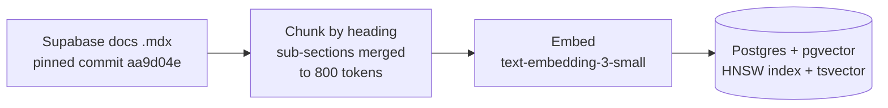
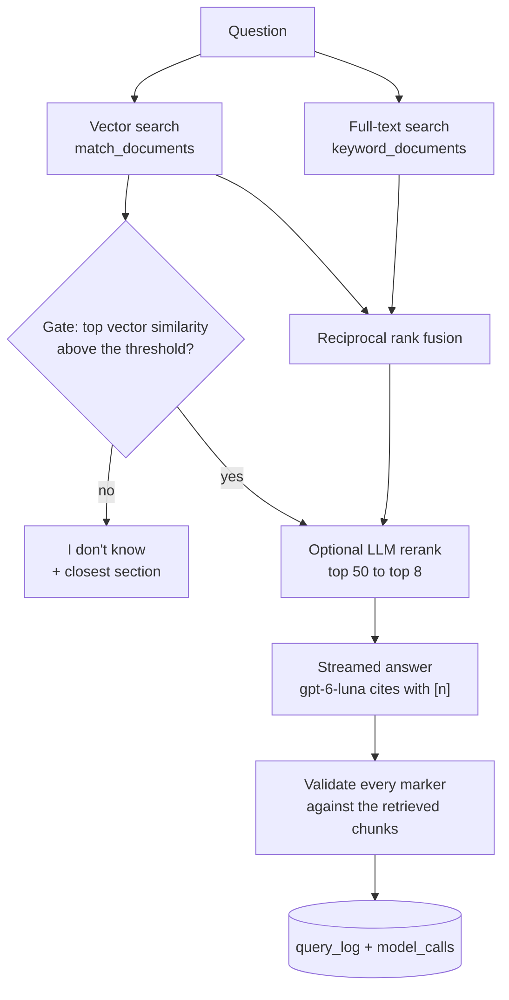

# CiteDesk

A documentation assistant that answers only from a given corpus and cites the exact passage behind every sentence, plus a retrieval eval suite that proves it finds the right passages.

> **Status: in the lab.** The demo runs on the Supabase Database and AI guides. The retrieval and generation numbers below show **Pending** until a 40-question labelled set exists; this README never reports a number that a run file doesn't contain.

**Live demo:** deployed and smoke-tested, but unlisted (`noindex`, not linked) until the case study is published; the link is added here then. · [Retrieval playground](#the-retrieval-playground) · [Case study draft](docs/case-study.md)

## What it does

You ask a question in plain language. CiteDesk finds the passages that could answer it, writes an answer in which **every sentence ends in a citation marker** like `[2]`, and checks in code that each marker points at a passage that was actually retrieved for that question. When retrieval isn't confident enough, it says **"I don't know"** and shows the closest section instead of guessing.

- Sources appear **before** the answer, so you can start checking while it is still being written.
- Click a marker and its source card opens to the full passage, with the wording closest to that sentence marked. That is a pointer by shared words, not a proof; whether the passage really supports the sentence is what the groundedness judge measures.
- Every question and every model call is logged with its tokens, cost and latency.

## How it works

**Offline: building the index** (`npm run ingest`)



**Per question**



The eval scripts (`npm run eval:*`) call this same retrieve-and-answer code, so what they measure is what the product does.

1. **Ingest** is offline and idempotent: a hash per file and per chunking setting means a re-run costs nothing when nothing changed. Chunks follow the docs' own headings, and each one's anchor is checked against the live site.
2. **Retrieval** runs a vector search and a full-text search, fuses them with reciprocal rank fusion, and can rerank the top 50 with one LLM call. Every stage is optional and measured separately.
3. **Refusal is decided in code**, from the top vector similarity, before the answer model is called. A refused question costs one embedding.
4. **Citations are markers validated in code**, not a provider feature, so "hallucinated citations = 0" is a count, not an opinion.
5. **Evals reuse the product's code**: `eval:retrieval`, `eval:generation` and `eval:judge` call the same functions the app does, and every number below comes from a run file in [`evals/runs/`](evals/runs/).

## Evidence

Retrieval ablation: each configuration scored on the same hand-labelled questions. Metric definitions and the scorer are in [`evals/`](evals/).

<!-- ablation:start -->
_Generated by `npm run eval:report` from the run files in `evals/runs/`. Don't edit by hand._

**Pending:** the question set has 3 of 40 labelled questions. Runs on a smaller set are plumbing checks and aren't reported.
<!-- ablation:end -->

### Diagnosis

Each answered question attributed to a stage: did retrieval send the labelled section to the model, and did the judge find the answer grounded in what it cited?

<!-- diagnosis:start -->
_Generated by `npm run eval:report` from the run files in `evals/runs/`. Don't edit by hand._

**Pending:** needs a generation run on 40 answerable and 10 unanswerable questions (the set has 3 and 0).
<!-- diagnosis:end -->

### Cost and caching

<!-- cache:start -->
_Generated by `npm run eval:report` from the run files in `evals/runs/`. Don't edit by hand._

Measured cost per question when the same 4 questions are asked three ways: first with prompt caching on (writing the cache), again as exact repeats (reading it), and with caching off. **n = 4 questions per pass, so this measures the mechanism; it is not a benchmark.**

| Configuration | First ask | Exact repeat | Caching off | Caching pays above | Run |
| --- | ---: | ---: | ---: | ---: | --- |
| Naive vector | $0.00030 | $0.00012 | $0.00025 | 31% repeats | [2026-11-06-cache-vector.json](evals/runs/2026-11-06-cache-vector.json) |
| Hybrid + rerank | $0.0017 | $0.00075 | $0.0014 | 31% repeats | [2026-11-06-cache-hybrid-rerank.json](evals/runs/2026-11-06-cache-hybrid-rerank.json) |

Caching pays when more than that share of questions are exact repeats within 30 minutes, because every new prompt is written to the cache at 1.25× the input price and a repeat reads it back at 0.1×.
<!-- cache:end -->

## Decisions, and what I measured

Small samples are named as such. Details and rejected alternatives are in the prompt file linked on each line.

- **Section-aware chunks, not fixed windows.** The docs' headings are the author's topic boundaries, and a citation anchor has to point at a heading that contains the passage. Sub-sections merge up to 800 tokens: 835 chunks, median 166 tokens, and 997 of 997 citation anchors match the live site ([prompt 004](prompts/004-phase-2-ingest.md)).
- **`LIMIT 50` silently returned 40 rows** at pgvector's default `hnsw.ef_search`, so `match_documents` sets it per call ([prompt 004](prompts/004-phase-2-ingest.md)).
- **Full-text search ORs the question's words.** Supabase's example ANDs them, which matched 0 of 835 chunks for three natural-sentence test questions ([prompt 007](prompts/007-phase-5-hybrid-rerank.md)).
- **Markers validated in code, not provider citations.** Provider-managed citations would hide the retrieval being measured ([prompt 005](prompts/005-phase-3-vector-answers.md)).
- **A stub page produced a confident, wrong-sourced answer.** One docs page is a single line pointing elsewhere; a question about it passed the gate and the model answered from memory, citing an unrelated section. That is why groundedness is judged, not only citation-checked ([prompt 005](prompts/005-phase-3-vector-answers.md)).
- **The refusal threshold is provisional (0.60) and probably too strict for paraphrased questions.** On a handful of test questions, correctly retrieved paraphrases scored below it. Tuning it is blocked on the 10 unanswerable questions, not on code ([prompt 009](prompts/009-phase-7-generation-evals.md)).
- **Prompt caching is a bet, so it is measured.** The table above is the evidence for keeping it on in the demo ([prompt 010](prompts/010-phase-8-operations-and-gate.md)).
- **Sources before the first token.** In one headless-Chrome run the first source card rendered 1.6 s before the answer text ([prompt 008](prompts/008-phase-6-product-surface.md)).

## The retrieval playground

`/playground` shows one question's whole path as data: every candidate's rank in the vector search, the full-text search, the fusion and the rerank, whether it was sent to the answer model, and whether the answer cited it. It is the fastest way to see *why* an answer looks the way it does.

## Run it yourself

```bash
cp .env.example .env.local     # OpenAI key, CiteDesk's own Supabase project, optional Langfuse keys
npm install
npm run corpus:fetch           # a sparse checkout of the pinned docs commit
npm run ingest -- --yes        # about $0.004 for the whole corpus
npm run dev                    # /demo and /playground
```

| Command | What it does |
| --- | --- |
| `npm run ask "…"` · `npm run search "…"` | One question from the terminal: answer or refusal, or just the top chunks (`-- --retrieval=hybrid`, `--rerank`) |
| `npm test` · `npm run typecheck` · `npm run lint` | Free checks, no network |
| `npm run eval:check` · `eval:keys` · `eval:label` | Validate question labels, list a page's chunk keys, label answers by hand |
| `npm run eval:retrieval` · `eval:threshold` · `eval:generation` · `eval:judge` · `eval:cache` | Paid evals; each prints an estimate and stops at `--max-usd` |
| `npm run eval:report` | Renders the three evidence blocks above from the run files (`-- --check` fails on drift) |
| `npm run eval:baseline` · `eval:gate` · `eval:smoke` | The 2-point regression gate CI runs |
| `npm run smoke:live -- --url=…` | Smoke-tests a running deployment |

CI ([`.github/workflows/`](.github/workflows/)) runs the free checks on every push, a retrieval-only smoke eval on push, and the full eval suite on pull requests to `main`. It skips with a notice when its secrets are missing.

## Limits worth knowing

- The demo answers **one question at a time**; there is no conversation memory.
- It covers **two guide sections** (Database and AI) of one product's docs, in English.
- The daily answer and rerank caps are **global**: one visitor can use up the day's budget, after which the demo shows a limit message until 00:00 UTC.
- The highlight in a source card is a shared-word heuristic, labelled as such.

## Prior art

Products that sell "ask your docs". These are what each vendor's own pages advertise (**vendor-claimed**, read 2 Nov 2026), not measurements; of the pages read, none published retrieval ablations.

| Product | Advertises | Link |
| --- | --- | --- |
| kapa.ai | Citations on every answer, an explicit "I don't know" guardrail, many connectors, docs widget and Slack bot | [vs Inkeep](https://www.kapa.ai/library/kapa.ai-vs-inkeep-(2026)-comparing-two-approaches-to-ai-for-technical-documentation) |
| Inkeep | A broader no-code agent builder with a TypeScript SDK | [inkeep.com](https://inkeep.com/) |
| Algolia Ask AI | A conversational assistant on top of Algolia search | [Ask AI](https://www.algolia.com/products/ai/ask-ai) |
| Mintlify | An "ask our docs" assistant in its own documentation | [mintlify.com](https://www.mintlify.com/docs/contact-support) |

## Licence and attribution

Code: [MIT](LICENSE). The documents it answers from are the Supabase docs, which are Apache-2.0: source commit `aa9d04e`, [supabase/supabase](https://github.com/supabase/supabase). Not affiliated with Supabase. The docs themselves are not stored in this repository.

Project context for contributors and coding agents: [`AGENTS.md`](AGENTS.md), [`CLAUDE.md`](CLAUDE.md).
